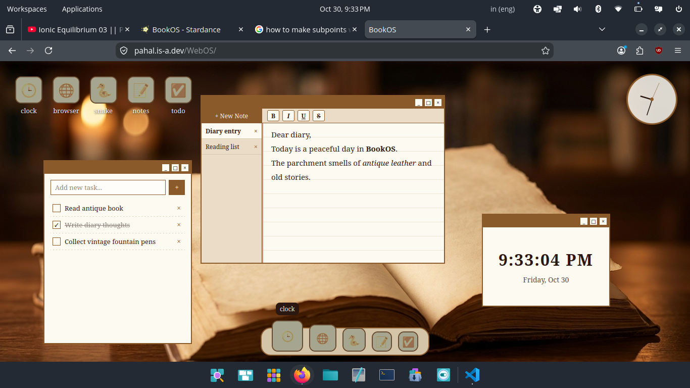

# BookOS

## what is this?
This is a book themed os running on the web! I have tried my best to mimic macOS style smooth animations and dock.

## Tech stack
I used html, css and javascript to make this

## Features
* Clock widget
* clock app
* macOS style dock
* macOS style minimise/maximise effect (genie effect)
* A notes app which has the following features:-
    * Lines like in ruled notebook
    * Strikethrough
    * Bold
    * Italics
    * Underline
    * Ability too make multiple notes
* A todo app

## Screenshots
